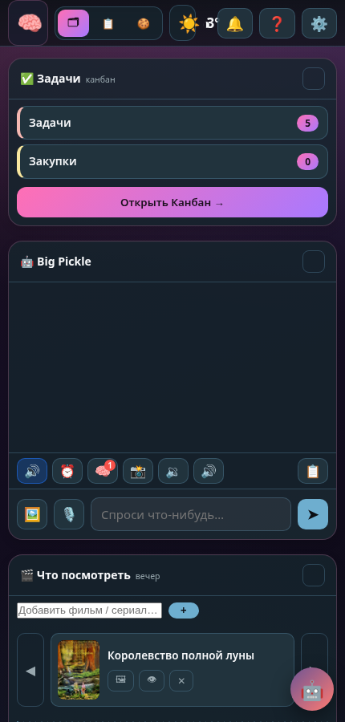

# Глава 4. CSS: стиль и раскладка

> **Цель главы:** сделать страницу красивой и понять три главных инструмента верстальщика: **селекторы**, **Flexbox** и **CSS-переменные** (из них в проекте построены темы).

---

## 4.1 Как CSS подключается и как устроен

```html
<link rel="stylesheet" href="/css/style.css">
```

Правило:

```css
селектор { свойство: значение; свойство2: значение2; }
```

```css
.card {
  background: rgba(255, 255, 255, .06);
  border: 1px solid rgba(255, 255, 255, .1);
  border-radius: 9px;
  padding: 9px 11px;
}
```

### Каскад и специфичность

Если два правила спорят, побеждает **более точное**. Порядок сравнения:

1. Селектор с `!important` — зло, не используйте без нужды.
2. Более специфичный селектор: `.card .title` точнее, чем `.card`; `#modal` точнее класса.
3. Если равные — позднее правило в файле.

```css
.card { color: #ccc; }           /* сработает */
.card { color: #fff; }           /* переопределит первое (позже в файле) */
.card-title { color: gold; }     /* для .card-title внутри .card — точнее */
```

> 💡 Проектная ловушка, о которой пишет AGENTS.md: для полей ввода приходится писать `.sm-pane input.sm-in`, потому что встроенный селектор `input[type=text]` по умолчанию **специфичнее** простого класса. Зная правило «каскада», вы это предсказываете.

**Задача 4.1.** Подключите `style.css` к странице из главы 3 и задайте фон `#1e2a3a`, текст `#e8eef5`. Откройте через DevTools → Styles и посмотрите, откуда берётся каждый стиль.

---

## 4.2 Основные селекторы

```css
.card { }                       /* все элементы с классом card */
#board { }                      /* элемент с id board */
.column .card { }               /* карточка внутри колонки */
.column > .card { }             /* только прямая дочерняя */
.card:hover { }                 /* при наведении */
.card.dragging { }              /* два класса сразу */
button.primary { }              /* кнопка с классом primary */
[data-col="c1"] { }             /* по атрибуту */
.card:nth-child(2n) { }         /* каждая вторая */
input:focus { }                 /* поле в фокусе */
```

Псевдоклассы, которые реально нужны: `:hover`, `:focus`, `:focus-within`, `:disabled`, `:checked`, `::placeholder`.

Псевдоэлементы (два двоеточия) — «часть элемента»: `::before`, `::after`.

**Задача 4.2.** Сделайте подсветку при наведении на пункты списка и рамку вокруг поля ввода в фокусе.

---

## 4.3 Цвета, отступы, типографика

```css
body {
  margin: 0;                       /* убираем стандартные отступы браузера */
  font-family: system-ui, sans-serif;
  font-size: 14px;
  line-height: 1.45;
  color: #e8eef5;
  background: #1e2a3a;
}
.card { padding: 10px; margin-bottom: 8px; border-radius: 10px; }
```

Модель коробки (box model) — представьте каждую карточку как матрёшку:

```text
┌──────────── border (рамка) ────────────┐
│  ┌──────── padding (внутренние поля) ─┐│
│  │   содержимое (текст/картинки)      ││
│  └────────────────────────────────────┘│
└──────────── margin (внешний отступ) ───┘
```

Глобальное правило, которое стоит в начале любого проекта:

```css
* { box-sizing: border-box; }  /* width означает «вместе с padding и border» */
```

Без него `width: 280px` + `padding: 10px` даст реально 300px — классическая головная боль новичков.

Цвета пишутся как угодно: `#rrggbb`, `rgb()/rgba()`, `hsl()`. В проекте активно используется **прозрачность**: `rgba(255,255,255,.06)` — почти прозрачная белая «плёнка» поверх фона.

---

## 4.4 Flexbox: раскладка «строкой»

90% вёрстки дашборда — это flex. Ставите контейнеру `display: flex`, и его дети выстраиваются в строку (или в столбец с `flex-direction: column`).

```css
#dash {
  display: grid;                  /* дашборд проекта — сетка (см. ниже) */
  gap: 14px;
  padding: 14px;
}
.dash-card {
  display: flex;
  flex-direction: column;
  background: rgba(22, 27, 34, .82);
  border: 1px solid rgba(255,255,255,.09);
  border-radius: 14px;
  overflow: hidden;
}
.dash-card-head {
  display: flex;                  /* заголовок: слева текст, справа кнопки */
  align-items: center;
  justify-content: space-between;
  padding: 10px 14px;
  border-bottom: 1px solid rgba(255,255,255,.08);
}
```

Самые нужные свойства:

| Свойство | Что делает |
|---|---|
| `display: flex` | Включает flex-контейнер |
| `flex-direction: column` | Направление: строка (по умолчанию) или столбец |
| `gap: 12px` | Расстояние между детьми (вместо margin-каши) |
| `justify-content: center \| space-between \| flex-end` | Выравнивание **вдоль** главной оси |
| `align-items: center \| stretch` | Выравнивание **поперёк** |
| `flex: 1` | «Забери всё свободное место» (текстовое поле в инпут-баре) |
| `flex: 0 0 280px` | Фиксированная ширина, не растягивать (колонка канбана) |
| `flex-wrap: wrap` | Переносить на новую строку, если не влезает |

### Сетка (CSS Grid)

Для «мозаики» дашборда:

```css
#dash { display: grid; grid-template-columns: repeat(auto-fill, minmax(320px, 1fr)); }
```

`repeat(auto-fill, minmax(320px, 1fr))` читается как: «сколько колонок по 320+ px влезет, столько и сделай, оставшееся раздели поровну». Автоматическая адаптация без media-запросов.

**Задача 4.3.** Сверстайте три «карточки» в ряд через flex: у первой `flex: 1`, у второй `flex: 2`, у третьей фиксированные `150px`. Поиграли с `gap` и `align-items`.

---

## 4.5 CSS-переменные и темы

Переменная — именованное значение, которое можно поменять в одном месте:

```css
:root {
  --panel: rgba(22, 27, 34, .82);
  --accent: #58a6ff;
  --text: #e8eef5;
  --muted: #9aa7b8;
  --border: rgba(255, 255, 255, .09);
}
.card { background: var(--panel); border: 1px solid var(--border); color: var(--text); }
a { color: var(--accent); }
```

А теперь магия: **значения можно менять «на лету» прямо из JavaScript** — и вся тема перекрашивается. Именно так устроен тёмный/светлый режим NeuroBoard:

```js
document.documentElement.style.setProperty('--accent', '#79c0ff');
```

А в `app.js:169` (`applyTheme`) — целый алгоритм: из доминирующего цвета картинки-фона вычисляется акцент, цвет панелей и границ:

```js
root.style.setProperty('--accent', this.rgbStr(acc));
root.style.setProperty('--panel', this.rgbStr(solid, 0.82));
root.style.setProperty('--border', this.rgbStr(acc, 0.28));
```

Ещё одна связка: атрибут на `<html>` + CSS-правило:

```html
<html data-theme="dark">
```
```css
:root[data-theme="light"] { --panel: #fff; --text: #14202e; }
```

**Задача 4.4.** Вынесите цвета своей страницы в `:root`, а потом добавьте кнопку-переключатель «тёмная/светлая», которая меняет `data-theme` у `<html>`.

---

## 4.6 Позиционирование: почему доска «плавает»

Канбан-колонки в проекте **не лежат в потоке документа**, а размещаются произвольно (как стикеры на стене):

```css
.column { position: absolute; }   /* вырываем из потока */
#board-inner { position: relative; }  /* контейнер = «стена», точка отсчёта */
```

| Значение | Поведение |
|---|---|
| `static` (по умолчанию) | Обычный поток |
| `relative` | Смещение относительно себя; служит «якорем» для absolute |
| `absolute` | Относительно ближайшего positioned-родителя; из потока исчезает |
| `fixed` | Относительно окна (топбар, кнопка 🤖, панель настроек) |

`z-index` решает, кто сверху: `div.style.zIndex = 100` при перетаскивании колонки (`app.js:295`) — чтобы она не «тонула» под соседями.

Ещё два свойства, которые встретятся:

```css
overflow: auto;      /* если содержимое не влезает — появится прокрутка */
position: sticky;    /* «прилипает» при прокрутке (шапка таблицы) */
```

**Задача 4.5.** Сделайте «доску»: контейнер `position: relative; height: 500px;` и три абсолютных «карточки» с разными `left/top/z-index`.

---

## 4.7 Адаптив: телефон

Один медиа-запрос закрывает 80% задач:

```css
@media (max-width: 700px) {
  #dash { grid-template-columns: 1fr; }
  .vs-label { display: none; }      /* подписи в шапке спрятать */
}
```

В проекте адаптив сделан комбинированно:

- CSS-grid `auto-fill/minmax` сам перестраивает карточки дашборда;
- несколько media-запросов в `style.css`/`layout.css`;
- JS проверяет ширину при старте (`app.js:28`: `window.matchMedia('(min-width: 1000px)')`) — если узко, ИИ-панель по умолчанию свёрнута.

Мобильный вид NeuroBoard:



**Задача 4.6.** Откройте свою страницу в DevTools в режиме мобильного устройства (иконка телефона, iPhone SE) и убедитесь, что ничего не «разъезжается».

---

## 4.8 Разбор стилей проекта

В `public/css/` лежит шесть файлов — слой за слоем:

| Файл | Содержимое |
|---|---|
| `base.css` | Сбросы, базовая типографика, кнопки, инпуты |
| `themes.css` | Светлая/тёмная тема через `data-theme` |
| `layout.css` | Каркас: топбар, дашборд, доска, боковые панели |
| `components.css` | Компоненты: чипы, дроеры, тосты |
| `dash.css` | Карточки дашборда |
| `style.css` | Старый «большой» файл + стили доски/модалок (1185 строк) |

Чтобы понять, откуда взялся стиль элемента: **кликните правой на элемент → Inspect**. Справа откроются все применяющиеся правила с указанием файла и строки — быстрее любого поиска по коду.

Кусок, который стоит запомнить (стиль «стеклянной панели» — фирменный приём проекта):

```css
background: rgba(22, 27, 34, .82);     /* полупрозрачный тёмный */
border: 1px solid rgba(255, 255, 255, .09);
border-radius: 14px;
backdrop-filter: blur(10px);           /* размытие фона под панелью */
```

**Задача 4.7.** Добавьте своей карточке «стеклянный» вид: полупрозрачный фон + `backdrop-filter: blur(8px)`. Убедитесь, что под ним что-то видно (например, градиентный фон `body`).

---

## 4.9 Чек-лист «CSS готов»

- [ ] Понимаю каскад и специфичность (что сработает, если два правила конфликтуют)
- [ ] Умею flex: `justify-content`, `align-items`, `flex: 1`, `gap`
- [ ] Знаю, зачем `box-sizing: border-box`
- [ ] Могу объяснить разницу `position: relative` / `absolute` / `fixed`
- [ ] Использую CSS-переменные и умею менять их из JS
- [ ] Страница не разваливается на ширине 375 px

---

## ✅ Задачи главы 4 (самостоятельная работа)

1. Оформить страницу из главы 3 в тёмной теме: панели, скругления, акцентный цвет.
2. Сделать переключатель темы на `data-theme` + кнопку.
3. Сверстать строку «заголовок слева, кнопка справа» через `display:flex; justify-content: space-between`.
4. Сделать мобильную раскладку в одну колонку через `@media`.
5. **Разбор реального кода.** В `public/css/style.css` найдите класс `.card` (карточка канбана) и перепишите его свойства своими словами: фон, рамка, отступы, курсор.

**Приёмка:** страница выглядит как «приложение», а не как документ Word; тема переключается; на телефонной ширине один столбец.

**Дальше → [Глава 5. JavaScript](05-javascript.md)**
