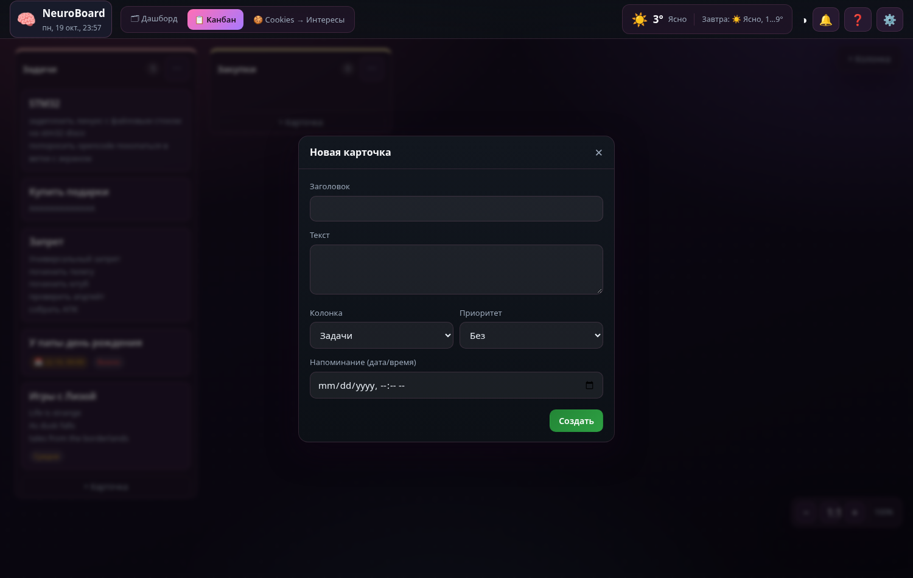

# Глава 8. Фронтенд канбана

> **Цель главы:** научиться превращать данные в интерфейс и обратно: рендер, модалки, перетаскивание карточек, а также разобраться с самой коварной темой проекта — координатами при масштабировании.

Это ядро проекта: `public/js/app.js` (1021 строка). Разберём его по частям.

---

## 8.1 Состояние: одно место правды

Весь фронтенд держит данные в одном объекте:

```js
window.APP = {
  db: null,       // ← сюда приходит JSON с сервера (/api/data)
  opts: {},
  async init() {
    this.db = await this.fetchData();   // сервер → память
    this.render();                      // память → экран
    …
  }
};
```

Схема работы, которую надо запомнить навсегда:

```text
       fetch('/api/data')                 render()
сервер ───────────────▶ APP.db ───────────────────▶ DOM
   ▲                                                │
   │              save()  (PUT /api/data)           │ клик/перетаскивание
   └──────────────────── APP.db ◀───────────────────┘
```

**Правило:** DOM никогда не является источником правды. Меняете данные в `APP.db` → зовёте `save()` и `render()`. Так интерфейс всегда соответствует данным.

---

## 8.2 Рендер колонок

```js
render() {
  const inner = document.getElementById('board-inner');
  inner.innerHTML = '';                        // 1. очистить
  const { columns, cards } = this.db.board;    // 2. взять данные
  const pos = this.colPos();                   // 3. позиции из localStorage
  let ax = 24, ay = 80;                        //    авто-раскладка «лесенкой»

  columns.forEach(col => {
    const colCards = cards.filter(c => c.columnId === col.id);   // 4. карточки колонки
    const div = document.createElement('div');
    div.className = 'column';
    div.dataset.col = col.id;
    div.style.setProperty('--col-color', col.color || '#888');

    let px = pos[col.id] ? pos[col.id].x : null;
    let py = pos[col.id] ? pos[col.id].y : null;
    if (px === null || py === null) {          // 5. новая колонка — кладём по сетке
      px = ax; py = ay; ax += 320;
      if (ax > safeMaxX) { ax = 24; ay += 400; }
    } else {                                   // 6. сохранённую позицию — в границы
      if (py < minTop) py = minTop;
      if (px > maxX) px = maxX;
    }
    div.style.left = px + 'px';
    div.style.top = py + 'px';
    div.innerHTML = `…разметка колонки…`;

    colCards.forEach(card => body.appendChild(this.makeCard(card)));  // 7. карточки
    inner.appendChild(div);
    this.bindColDrag(div, col.id);             // 8. перетаскивание заголовка
  });
}
```

Разбор по шагам:

1. **Полная перерисовка.** Да, это «грубо»: каждый раз строим DOM заново. Для 10–50 карточек это мгновенно, а код становится простым и надёжным. Оптимизация (точечные обновления) понадобилась бы при тысячах элементов — поймёте почему, прочитав главу про производительность дальше.
2. **`data-*` атрибуты** (`dataset.col`, `dataset.card`) — связь DOM и данных.
3. **CSS-переменная `--col-color`** — задаём цвет колонки прямо из данных, а стиль берёт его (`border-color: var(--col-color)`).
4. **Позиционирование абсолютное** (`position: absolute; left/top`), потому что доска — свободная «стена», а не список.

**Задача 8.1.** Упростите `render()` вдвое: уберите сохранение позиций (всегда auto-раскладка сеткой). Убедитесь, что доска работает; потом верните позиции — «так лучше».

---

## 8.3 Карточка и её данные

`makeCard` (см. полный код в гл. 3.5) строит DOM из объекта. Обратите внимание на «чипы» (метки) — приоритет и дедлайн:

```js
if (card.priority) {
  const pn = { high: ['Важно', 'prio-p'], med: ['Средне', 'prio-m'], low: ['Низкий', 'prio-l'] }[card.priority] || [];
  if (pn[0]) meta += `<span class="chip ${pn[1]}">${pn[0]}</span>`;
}
```

Это приём «таблица соответствий вместо if-else»: значение из данных → пара «подпись + класс». Очень удобно для статусов, категорий, тем.

---

## 8.4 Модальные окна

Модалка — это один-единственный `<div id="modal">` в разметке, в который подставляется разный HTML:

```js
openModal(html) {
  const modal = document.getElementById('modal');
  modal.classList.remove('hidden');
  modal.innerHTML = `<div class="overlay" data-close-overlay></div><div class="modal-card">${html}</div>`;
  modal.querySelector('[data-close-overlay]').onclick = () => this.closeModal();
  modal.querySelector('[data-close-modal]')?.addEventListener('click', () => this.closeModal());
},
closeModal() {
  const modal = document.getElementById('modal');
  modal.classList.add('hidden');
  modal.innerHTML = '';     // важно: убираем за собой
}
```

Плюсы подхода: один обработчик закрытия, единый стиль, никаких «наслоений» модалок.

Пример использования — добавление карточки (`app.js:394`):

```js
openCardModal(card) {
  const isNew = !card.id;
  this.openModal(`
    <div class="modal-head"><h3>${isNew ? 'Новая карточка' : 'Карточка'}</h3>
      <button class="close-btn" data-close-modal>✕</button></div>
    <div class="modal-body">
      <label>Заголовок</label><input type="text" id="m-card-title" value="${this.esc(card.title)}">
      <label>Текст</label><textarea id="m-card-text">${this.esc(card.text || '')}</textarea>
      <label>Приоритет</label><select id="m-card-prio">…</select>
      <label>Напоминание</label><input type="datetime-local" id="m-card-due">
    </div>
    <div class="modal-foot">
      <button class="btn primary" data-save-card>${isNew ? 'Создать' : 'Сохранить'}</button>
    </div>`);

  document.querySelector('[data-save-card]').onclick = () => {
    const t = document.getElementById('m-card-title').value.trim();
    if (!t) return;                              // валидация: без названия не сохраняем
    const updated = { id: card.id || 'card_' + Date.now().toString(36),
                      columnId: document.getElementById('m-card-col').value,
                      title: t, text: …, priority: …, due: … };
    if (isNew) this.db.board.cards.push(updated);
    else Object.assign(card, updated);           // редактируем «по месту»
    this.save(); this.render(); this.closeModal();
  };
}
```



> 📌 Шаблонная вставка `value="${this.esc(card.title)}"` защищает от поломки атрибута кавычками в названии. Без `esc` карточка с title `"` сломает разметку модалки.

**Задача 8.2.** Добавьте в модалку карточки поле «исполнитель» и выведите его чипом на карточке. Данные должны сохраняться и приходить с сервера (проверьте `data/db.json`).

---

## 8.5 Toast-уведомления

Лёгкое всплывающее сообщение в углу:

```js
toast(title, msg, warn = false) {
  const t = document.createElement('div');
  t.className = 'toast' + (warn ? ' warn' : '');
  t.innerHTML = `<div class="toast-title">${this.esc(title)}</div>${msg ? `<div class="toast-msg">${this.esc(msg)}</div>` : ''}`;
  document.getElementById('event-toasts').appendChild(t);
  setTimeout(() => {
    t.style.opacity = '0'; t.style.transform = 'translateX(100%)';
    t.style.transition = 'all .3s';
    setTimeout(() => t.remove(), 400);          // обязательно удаляем из DOM
  }, 7000);
}
```

Приёмы: добавляем в контейнер (`#event-toasts`), анимация через `style` + CSS-transition, **удаляем элемент после** — иначе DOM будет расти бесконечно (утечка).

---

## 8.6 Перетаскивание карточек между колонками

Используется встроенный HTML5 drag&drop. На карточке:

```js
el.draggable = true;
el.ondragstart = (e) => {
  el.classList.add('dragging');
  e.dataTransfer.setData('text/plain', card.id);  // «в чемодан» положили id
  e.dataTransfer.effectAllowed = 'move';
};
el.ondragend = () => el.classList.remove('dragging');
```

На доске-контейнере (`app.js:976`):

```js
board.addEventListener('dragover', (e) => {
  e.preventDefault();                         // БЕЗ этого drop не сработает
  e.dataTransfer.dropEffect = 'move';
  const card = e.target.closest('.card');
  if (card) card.classList.add('drop-hint');  // подсветка «сюда можно»
});
board.addEventListener('drop', (e) => {
  e.preventDefault();
  board.querySelectorAll('.drop-hint').forEach(x => x.classList.remove('drop-hint'));
  const cardId = e.dataTransfer.getData('text/plain');   // достали id из чемодана
  const colBody = e.target.closest('.col-body');
  if (!cardId || !colBody) return;
  const card = this.db.board.cards.find(c => c.id === cardId);
  if (card) { card.columnId = colBody.dataset.col; this.save(); this.render(); }
});
```

Три ключевых момента:

- `e.preventDefault()` в `dragover` — иначе браузер не разрешит бросок.
- Данные «летят» через `dataTransfer` (в нём можно хранить только строку — id!).
- После изменения данных — `save()` + `render()`. **Никакого ручного перемещения DOM.**

### Тач-экраны

HTML5 drag&drop на телефоне не работает. Проект делает так: **долгое нажатие (450 мс) «берёт» карточку**, потом тап по нужной колонке кладёт её (`app.js:996`):

```js
document.addEventListener('touchstart', (e) => {
  const card = e.target.closest('.card');
  if (!card) return;
  touchTimer = setTimeout(() => { touchCard = card.dataset.card; card.style.outline = '2px solid var(--accent)'; }, 450);
}, { passive: true });

document.addEventListener('touchend', (e) => {
  clearTimeout(touchTimer);
  if (!touchCard) return;
  const t0 = e.changedTouches[0];
  const el = document.elementFromPoint(t0.clientX, t0.clientY);   // что под пальцем
  const colBody = el && el.closest('.col-body');
  if (colBody) { … card.columnId = colBody.dataset.col; this.save(); this.render(); }
});
```

Приём `document.elementFromPoint(x, y)` — «что находится в этой точке экрана» — пригодится ещё не раз.

**Задача 8.3.** Добавьте в свой мини-канбан drag&drop: карточки переносятся мышью (dragstart/dragover/drop), а на телефоне — долгое нажатие + тап.

---

## 8.7 Перетаскивание колонок (pointer-events)

Заголовок колонки можно тянуть — колонка «плавает». Так как обычный drag&drop плохо дружит с абсолютным позиционированием внутри контейнера, используется pointer-модель:

```js
head.addEventListener('pointerdown', (e) => {
  if (e.button !== 0) return;
  if (e.target.closest('button')) return;         // не мешаем кнопкам
  e.preventDefault();
  const p0 = C.toCanvas(e.clientX, e.clientY);    // точка старта в координатах доски
  const start = { p0, sx: div.offsetLeft, sy: div.offsetTop };
  head.setPointerCapture(e.pointerId);            // события пойдут сюда, даже если ушли с элемента
});
head.addEventListener('pointermove', (e) => {
  if (!start) return;
  const p = C.toCanvas(e.clientX, e.clientY);
  div.style.left = Math.min(maxX, start.sx + (p.cx - start.p0.cx)) + 'px';
  div.style.top  = Math.max(minTop, start.sy + (p.cy - start.p0.cy)) + 'px';
});
head.addEventListener('pointerup', () => {
  pos[colId] = { x: div.offsetLeft, y: div.offsetTop };
  localStorage.setItem('kban-cols', JSON.stringify(pos));   // запомнили позицию
});
```

Приёмы, которые стоит запомнить:

- **`setPointerCapture`** — после него `pointermove/up` приходят на этот элемент, даже если курсор улетел далеко. Надёжнее, чем слушать `document`.
- **Смещение от старта** (`start.sx + (p.cx - p0.cx)`), а не «колонка прыгает под курсор» — правильная механика перетаскивания.
- **Ограничение границами** (`Math.min/Math.max`), чтобы не потерять колонку за краем.
- **Позиции — в localStorage**, потому что это удобство конкретного браузера, а не данные доски.

**Задача 8.4.** Доведите перетаскивание колонок в мини-канбане: тянуть за заголовок, сохранять позицию в `localStorage`, возвращать в границы.

---

## 8.8 Самое сложное: координаты при масштабировании

В проекте есть **глобальный зум** (`public/js/canvas.js`): `document.documentElement.style.zoom = 0.15…3`. Это невероятно коварная вещь, потому что браузер возвращает координаты в разных системах.

Правила (выучить обязательно):

| Что | В каких единицах |
|---|---|
| `getBoundingClientRect()`, `clientX/clientY`, `scrollX/scrollY` | **визуальные** — уже умножены на зум |
| `offsetLeft/Top/Width/Height`, `style.left/top`, `scrollWidth` | **layout** — делить на масштаб, чтобы получить «настоящие» |
| `window.innerWidth/innerHeight` | визуальные; видимая область в layout = `innerWidth / scale()` |
| CSS `vw`/`vh` | **не масштабируются** зумом |

Мост между системами — `CANVAS.toCanvas`:

```js
function toCanvas(cx, cy) {
  const sc = scroll();
  return { cx: (sc.x + cx) / st.s, cy: (sc.y + cy) / st.s };
}
```

И зум «под курсором» — чтобы точка под мышью не убегала:

```js
function zoomAt(clientX, clientY, factor) {
  const pc = toCanvas(clientX, clientY);   // что под курсором в layout
  st.s = clampS(st.s * factor);            // меняем масштаб
  scrollTo(pc.cx * st.s - clientX, pc.cy * st.s - clientY);   // прокручиваем так, чтобы точка осталась
  apply(); save();
}
```

`apply()` — единственное место, где меняется зум:

```js
function apply() {
  document.documentElement.style.zoom = String(st.s);
  document.documentElement.style.setProperty('--z', String(st.s));
  zoomPctEl.textContent = Math.round(st.s * 100) + '%';
}
```

А `--z` нужен в CSS, потому что `vw/100` не масштабируется:

```css
.side-panel { width: calc(100vw / var(--z)); }   /* вручную делим на зум */
```

Плюс функции «безопасных границ» — куда можно ставить панели, чтобы не залезть под топбар и правую ИИ-панель:

```js
function safeTop() {                         // низ топбара + текущая прокрутка
  const h = document.getElementById('topbar').getBoundingClientRect().height / st.s;
  return Math.ceil(h + 6 + scrollY / st.s);
}
function safeRight() {                       // левее правой ИИ-панели
  const w = window.innerWidth / st.s;
  const dock = …('--ai-w');                  // ширина правой панели
  return Math.ceil(w - dock + scrollX / st.s);
}
```

Их используют и `render()` (не ставить колонки под панель), и `place.js` (раскладка окон), и перетаскивание.

> 🔥 **Это самая частая причина «поехавших» координат в подобных проектах.** Запомните фразу: *«clientX визуальный, offsetLeft layout»*. Если элемент «уезжает» при зуме — вы смешали две системы.

**Задача 8.5.** Добавьте в мини-канбан зум (Ctrl+колесо), но без сохранения границ: посмотрите, что произойдёт при перетаскивании карточки, если забыть `toCanvas`. Затем исправьте через `toCanvas` — и почувствуйте разницу.

---

## 8.9 Инициализация и порядок вещей

```js
document.addEventListener('DOMContentLoaded', () => APP.init());
```

`DOMContentLoaded` — момент, когда разметка готова. Только после него можно искать элементы. Поэтому все `<script>` стоят в конце `<body>`, а инициализация — по событию.

Внутри `init()` (см. `app.js:7`) важный порядок:

```js
async init() {
  this.db = await this.fetchData();   // 1) данные
  this.render();                      // 2) доска
  if (window.PLACE) PLACE.reload();   // 3) окна-панели
  this.initClock(); this.applyBg();   // 4) мелочи
  this.initDragTouch();               // 5) обработчики
  this.updateEventsBadge();
  setInterval(() => this.checkEvents(), 20000);  // 6) напоминания

  document.getElementById('btn-settings').onclick = …;   // 7) кнопки
}
```

Правило: **сначала данные и рендер, потом обработчики** (обработчикам нужен готовый DOM).

---

## 8.10 Чек-лист «Фронтенд готов»

- [ ] Единое состояние (`APP.db`), DOM — только отражение
- [ ] `render()` умеет полностью перестроить вид из данных
- [ ] Модалки: один контейнер, вставка HTML, аккуратное закрытие
- [ ] `esc()` применяется ко всем пользовательским строкам
- [ ] Drag&drop: `dataTransfer` хранит id, `preventDefault` в `dragover`
- [ ] Тач-вариант перетаскивания работает (долгий тап + тап)
- [ ] Понимаю правило «clientX — визуальные, offsetLeft — layout»
- [ ] Тост удаляется из DOM после показа

---

## ✅ Задачи главы 8 (самостоятельная работа)

1. **Свой render.** Возьмите страницу из главы 5 и перепишите её так, чтобы она рисовалась функцией `render(state)` из массива данных (не трогая DOM вручную).
2. **Модалка.** Сделайте модалку добавления карточки: поля «заголовок», «колонка», «приоритет»; сохранение через `save()`.
3. **Drag&drop** (8.3) для карточек + тач-вариант.
4. **Перетаскивание колонок** (8.4) с сохранением в `localStorage`.
5. **Зум.** Реализуйте Ctrl+колесо с якорем под курсором (как `zoomAt`) и кнопку сброса `1:1`.
6. **Разбор.** В `public/js/app.js` найдите `initResizer` (перетаскивание границы ИИ-панели). Объясните, зачем там деление на `CANVAS.scale()` и `Math.min(…, 640)`.

**Приёмка:** доска добавляет/редактирует/удаляет карточки, перетаскивает их мышью и пальцем, меняет позиции колонок, и всё это сохраняется после перезагрузки.

**Дальше → [Глава 9. Уведомления в реальном времени](09-realnoe-vremya.md)**
