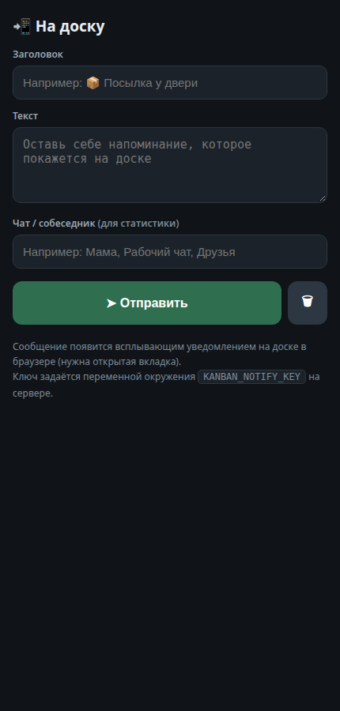

# Глава 9. Уведомления в реальном времени

> **Цель главы:** научиться «пушить» данные с сервера в браузер мгновенно, без перезагрузки — и построить самую полезную фичу проекта: уведомления со смартфона на доску.

---

## 9.1 Зачем «реальное время»

Доска и так синхронизируется: сделал — сохранил. Но есть сценарии, где этого мало:

- SMS/звонок/будильник с телефона должен всплыть **на доске сразу**;
- наступило напоминание о задаче;
- кто-то другой открыл доску с телефона и что-то поменял — хорошо бы увидеть.

Варианты доставки «сейчас же»:

| Способ | Как работает | Минусы |
|---|---|---|
| **Polling** (опрос) | Клиент каждые 3 с спрашивает «есть новое?» | Задержка, лишний трафик, нагрузка |
| **Long-polling** | Запрос висит, пока нет данных | Сложновато, много открытых запросов |
| **WebSocket** | Двусторонний канал | Нужен ручной протокол, сложнее |
| **SSE** (Server-Sent Events) | Сервер сам пишет в открытый ответ | Только «сервер → клиент» |

Проект выбрал **SSE**: он встроен в браузер (`EventSource`), не требует библиотек, автоматически переподключается. Идеально для «сервер пушит события».

---

## 9.2 SSE на сервере: 10 строк

SSE — это обычный HTTP-ответ, который **не закрывается**. Ключ — заголовок `Content-Type: text/event-stream` и формат строк `data: …\n\n`:

```js
if (req.method === 'GET' && p === '/api/notify/events') {
  res.writeHead(200, {
    'Content-Type': 'text/event-stream; charset=utf-8',
    'Cache-Control': 'no-cache',
    Connection: 'keep-alive'
  });
  res.write(':ok\n\n');                     // комментарий-подтверждение (строки с ':' игнорируются)

  clients.add(res);                         // запомнили «трубу» к этому браузеру

  const timer = setInterval(() => {         // keep-alive, чтобы прокси не закрыл канал
    try { res.write(':k\n\n'); } catch (e) { clearInterval(timer); }
  }, 25000);

  req.on('close', () => {                   // клиент ушёл — убираем и остановили таймер
    clearInterval(timer);
    clients.delete(res);
  });
  return true;
}
```

Отправка события (при добавлении уведомления, `notify.js:87`):

```js
for (const c of clients) {
  try { c.write('data: ' + JSON.stringify({ type: 'phone', item: rec }) + '\n\n'); }
  catch (e) { clients.delete(c); }          // мёртвую трубу выкидываем
}
```

Запомните формат: **два перевода строки** отделяют событие; `data:` — полезная нагрузка. Можно ещё `event: имя` (своё имя события) и `id:` (для докачки после обрыва).

---

## 9.3 SSE на клиенте: EventSource

```js
const es = new EventSource('/api/notify/events');

es.onmessage = (ev) => {
  const d = JSON.parse(ev.data);
  if (d.type !== 'phone' || !d.item) return;
  // показали тост, звук, системное уведомление, добавили в историю
};

es.onerror = () => {};   // EventSource сам переподключится через несколько секунд
```

Особенности:

- `EventSource` **сам** переподключается при обрыве (по умолчанию ~3 с). Не нужно писать цикл.
- `onerror` вызывается и при штатном обрыве сервера — не пугайтесь.
- Отменить: `es.close()`.
- Клиент получает только текст (`ev.data`), парсить JSON вручную.

В проекте `public/js/notify.js:87` — именно этот код, плюс умная обработка «повтора истории»:

```js
es.onmessage = (ev) => {
  let d; try { d = JSON.parse(ev.data); } catch (e) { return; }
  if (d.type !== 'phone' || !d.item) return;
  const it = d.item;
  if (isPrivate(it)) return;                     // банковские уведомления — мимо
  if (d.replay) {                                // при подключении сервер шлёт 20 последних
    if (!replayTimer) replayTimer = setTimeout(() => { replayTimer = null; loadHistory(); }, 150);
    return;                                      // …и не надо на каждое дёргать запрос!
  }
  const title = '🔔 ' + it.app + ': ' + it.title;
  toast(title, it.text);                         // всплывашка на доске
  notify(title, it.text);                        // системное уведомление браузера
  NOTIFY_SOUND.play(it.app, it.title, it.text);  // звук по правилам
  NOTIF_DRAWER.push(it);                         // колокольчик-дроер
  pushLive(it);                                  // обновить вкладку истории
};
```

---

## 9.4 Приём с телефона: POST `/api/notify/send`

Телефон (приложение-автоматизация) шлёт HTTP-запрос на ваш ПК:

```bash
curl -X POST http://192.168.1.100:8080/api/notify/send \
  -H 'Content-Type: application/json' \
  -d '{"title":"Мама","text":"Позвони мне","app":"Телефон","chat":"Мама"}'
```

Сервер (`notify.js:110`) умеет главное:

1. **Проверить необязательный ключ** (если задан `KANBAN_NOTIFY_KEY`);
2. **Разобрать тело** — и JSON, и `form-urlencoded`;
3. **Отсеять приватное** (банковские SMS) и **дубликаты**;
4. **Разослать по всем SSE-клиентам**;
5. Вернуть `{ok:true, id}`.

### Хитрость с разбором тела

Реальная проблема из жизни: Android-приложение MacroDroid шлёт JSON, но с заголовком `Content-Type: application/x-www-form-urlencoded`. Наивный сервер попытается разобрать это как форму и получит пустоту → ошибка 400. Поэтому код сначала смотрит на **содержимое**, а не на заголовок (`notify.js:119`):

```js
if (trimmed.startsWith('{') || ctype.includes('json')) {
  try { body = JSON.parse(trimmed); } catch (e) {}
}
if (!(body.title || body.text)) {
  if (ctype.includes('application/x-www-form-urlencoded') || trimmed.includes('&')) {
    for (const pair of trimmed.split('&')) { /* title=...&text=... */ }
  }
}
```

**Урок:** клиенты бывают кривыми; сервер должен быть снисходительным ко входным форматам.

### Защита от спама: дедупликация

Форвардер уведомлений часто шлёт одно и то же по нескольку раз в секунду (прогресс «Отправка видео… 30%», «31%»…). Поэтому в окне 30 секунд **идентичные** записи отбрасываются (`notify.js:45`):

```js
const DEDUP_WINDOW = 30000;
function fpOf(x) {   // отпечаток: app + title + text + user + chat, всё в нижнем регистре
  return [x.app, x.title, x.text, x.user, x.chat].map(v => String(v ?? '').toLowerCase()).join('\u0000');
}
function isDuplicate(rec) {
  if (!DEDUP_WINDOW) return false;
  const fp = fpOf(rec);
  for (let i = 0; i < history.length && i < 60; i++) {
    if (Date.now() - history[i].ts > DEDUP_WINDOW) break;
    if (fpOf(history[i]) === fp) return true;
  }
  return false;
}
```

### Защита приватности

Банковские SMS и платёжные пуши **фильтруются регулярками** и до сохранения, и до отправки в интерфейс (`notify.js:21`):

```js
const PRIVACY_APP_RE = /сбер|тиньк|tinkoff|втб|альфа|…|банк|bank/i;
const PRIVACY_TEXT_RE = /…|карт|счет|счёт|плат[её]ж|оплат|списан|зачислен|перевод|…\d[\d\s]{2,}\s?(₽|руб)/i;
function isPrivate(item) {
  const s = app + ' ' + title + ' ' + text;
  return PRIVACY_APP_RE.test(app) || PRIVACY_TEXT_RE.test(s);
}
```

Тот же фильтр продублирован на клиенте — «второй замок» (даже если что-то просочилось, оно не покажется). **Принцип: чувствительные данные не должны покидать сервер и не должны попадать в ИИ-контекст.**

**Задача 9.1.** Добавьте в свой мини-канбан `/api/notify/send` + SSE-поток. Проверьте через `curl` в одном терминале (отправка) и открытую страницу в браузере (должен всплыть тост).

---

## 9.5 Страница для телефона

Чтобы не настраивать автоматизацию сразу, в проекте есть простая страница `public/notify.html`, открытая с телефона:



Она делает ровно один `fetch`:

```html
<form id="f">
  <input id="title" placeholder="Заголовок">
  <textarea id="text" placeholder="Текст"></textarea>
  <input id="app" placeholder="Приложение (необязательно)">
  <button>Отправить</button>
</form>
<script>
f.onsubmit = async (e) => {
  e.preventDefault();
  const r = await fetch('/api/notify/send', {
    method: 'POST',
    headers: { 'Content-Type': 'application/json' },
    body: JSON.stringify({ title: title.value, text: text.value, app: app.value })
  });
  status.textContent = r.ok ? 'Отправлено ✓' : 'Ошибка';
};
</script>
```

---

## 9.6 Автоматизация на Android (реальная инструкция)

Чтобы уведомления шли сами, поставьте одно из приложений: **HTTP Shortcuts**, **MacroDroid**, **Tasker**, **Notification Forwarder**. Схема одна:

| Параметр | Значение |
|---|---|
| Метод | `POST` |
| URL | `http://192.168.1.100:8080/api/notify/send` |
| Header | `Content-Type: application/json` |
| Body | `{"title":"%title%","text":"%text%","app":"%app%"}` |

Где `%…%` — переменные, которые приложение подставляет из самого уведомления. В HTTP Shortcuts это делается через «Trigger: notification received», в MacroDroid — через макрос с триггером уведомления.

Если на сервере задан ключ — добавьте заголовок `x-notify-key: ВАШ_КЛЮЧ` (или `?key=ВАШ_КЛЮЧ`).

**Задача 9.2.** Настройте на своём телефоне (если Android) авто-пересылку уведомлений от мессенджера на свой мини-канбан. Если iPhone — используйте приложение «Команды» с «Get Contents of URL» и автоматизацией «Когда получено уведомление» (ограничения iOS строже).

---

## 9.7 Звук и системные уведомления браузера

```js
// системное уведомление ОС
if (Notification.permission === 'granted') new Notification(title, { body });
else if (Notification.permission !== 'denied') Notification.requestPermission();

// звук через <audio>, который лежит в разметке
const a = document.getElementById('notif-sound');
a.src = '/sounds/notify.mp3';
a.volume = 0.8;
a.play().catch(() => {});   // автоплей может быть заблокирован — глотаем ошибку
```

Два подводных камня:

1. **Автоплей заблокирован**, пока пользователь не взаимодействовал со страницей. Поэтому `.play()` всегда с `.catch()`.
2. `Notification.requestPermission()` надо вызывать **по действию пользователя** (клик), иначе браузер откажет.

Модуль звуков проекта устроен так: `data/sounds.json` содержит `{default, rules[]}`, а `pick(app,title,text,…)` выбирает звук по подстроке в правилах (`sounds.js`). Это отличный пример «конфига фичи в отдельном JSON».

---

## 9.8 Главный урок проекта: лимит соединений

**Браузер держит максимум 6 соединений на один хост (HTTP/1.1).** Каждый долгоживущий SSE/stream занимает слот **навсегда**. Если открыть 6 долгих потоков — **любой** новый запрос зависнет.

Это в проекте уже случалось: «SSE недоступен» при импорте cookies. Поэтому правила (из `AGENTS.md`):

- Базовых потоков — **4** максимум: `notify`, `smart`, `ops`, `assist`.
- Консоль (`/api/console/events`) грузится **только при открытии вкладки** — не заранее.
- `ops` и `stats` слушают **один** поток (общая шина `window.OPS.subscribe`).
- Прогресс импорта — **короткими опросами**, а не SSE.
- Реплеи истории уведомлений **батчатся** в один перезапрос, а не по запросу на каждую запись.

Диагностика:

```bash
ss -tn | grep ':8080'    # сколько соединений к серверу (каждое видно с двух сторон ×2)
```

> Проектируя любую «живую» фичу, задайте вопрос: **«Сколько долгих потоков у меня открыто одновременно?»** Если больше ~4 — ищите способ объединить или перейти на короткие опросы.

**Задача 9.3.** Откройте DevTools → Network → фильтр `EventSource`/`events`. Посчитайте, сколько долгих потоков держит доска. Объясните, почему консоль грузится только по открытию вкладки.

---

## 9.9 Чек-лист «Реальное время готово»

- [ ] Понимаю разницу polling / SSE / WebSocket и почему выбран SSE
- [ ] Сервер: `text/event-stream`, `data: …\n\n`, keep-alive, список клиентов, удаление мёртвых
- [ ] Клиент: `EventSource`, `onmessage`, авто-reconnect
- [ ] Приём POST: устойчив к разным форматам тела, валидирует
- [ ] Есть дедупликация и фильтр приватности
- [ ] Уведомления приходят на доску с телефона
- [ ] Знаю про лимит 6 соединений и не открываю лишних потоков

---

## ✅ Задачи главы 9 (самостоятельная работа)

1. **SSE-«часики».** Сделайте сервер, который каждые 2 с шлёт `{time: Date.now()}` в поток, и страницу, которая обновляет цифру без перезагрузки.
2. **Живая доска.** В мини-канбане сделайте SSE: при добавлении карточки с другого устройства она появляется сама. Проверьте **два окна браузера** рядом.
3. **Приём с телефона** (9.2).
4. **Дедуп и приватность.** Добавьте в свой notify-эндпоинт дедупликацию 10 с и фильтр по слову «пароль».
5. **Звук.** Подключите `<audio>` и выбирайте один из двух звуков по полю `app`.
6. **Диагностика.** Откройте `ss -tn | grep ':8090'` при одном и двух открытых SSE-клиентах, объясните числа.

**Приёмка:** отправка `curl` приводит к мгновенному появлению уведомления в браузере; два окна видят изменения друг друга; ничего не дублируется.

**Дальше → [Глава 10. Модули и как добавлять фичи](10-moduli-i-fichi.md)**
