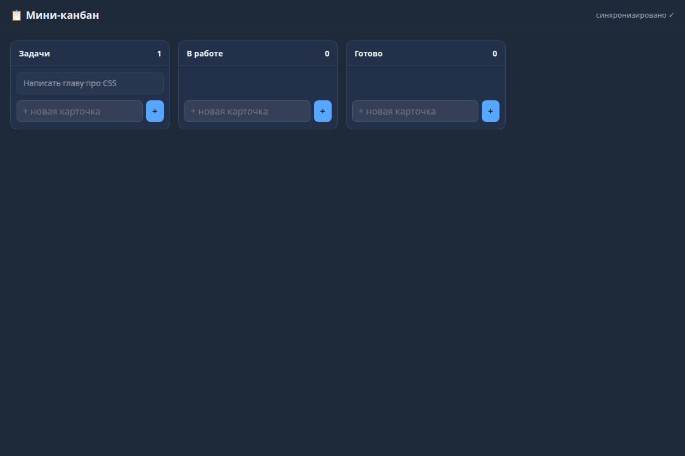

# Глава 11. Итоговый проект по шагам

> **Цель главы:** собрать всю канбан-доску целиком, по этапам, с приёмкой после каждого. К концу у вас — рабочее приложение, которое открывается с ПК и телефона и хранит данные.

---

## 11.1 Что должно получиться

Мини-версия NeuroBoard:

```text
my-kanban/
├── server.js                 ← HTTP-сервер: статика + API (глава 6)
├── package.json              ← npm start
├── .gitignore                ← data/, config.json
├── data/
│   └── db.json               ← доска (создаётся сама)
└── public/
    ├── index.html            ← разметка (главы 3–4)
    ├── css/style.css         ← стили (глава 4)
    ├── js/app.js             ← состояние + рендер + drag&drop (глава 8)
    ├── js/notify.js          ← SSE + звук (глава 9)
    └── js/habits.js          ← своя фича-модуль (глава 10, по желанию)
```

Целевой результат (реальный, проверенный пример курса):



---

## 11.2 Этапы сборки

### Этап 0. Каркас (20 минут)

```bash
mkdir -p ~/my-kanban/{public/css,public/js,data}
cd ~/my-kanban
npm init -y
```

- [ ] `package.json` содержит `"scripts": {"start": "node server.js"}`
- [ ] `.gitignore`: `node_modules/`, `data/`, `config.json`
- [ ] `git init && git add . && git commit -m "каркас"`

**Приёмка:** `git log` показывает коммит, папки на месте.

### Этап 1. Страница (1–2 часа) — глава 3

Сверстайте `public/index.html`: шапка с названием, `<main id="board">`, контейнер для модалки, `<script src="/js/app.js">`.

- [ ] Семантические теги (`header`, `main`, `section`, `button`)
- [ ] Есть `#board`, `#modal`, `#toasts`
- [ ] Подключены `style.css` и `app.js`

**Приёмка:** открывается двойным кликом, структура видна в DevTools.

### Этап 2. Стиль (2–3 часа) — глава 4

- [ ] Тёмная тема через переменные `:root`
- [ ] Колонки — `flex`, карточка со «стеклянным» фоном
- [ ] Мобильная раскладка (`@media`)
- [ ] `box-sizing: border-box` глобально

**Приёмка:** страница выглядит как приложение; на ширине 375 px всё влезает.

### Этап 3. Состояние и рендер (2–3 часа) — главы 5, 8

`public/js/app.js`:

- [ ] `const state = { columns: [...], cards: [] }`
- [ ] `render()` строит колонки/карточки из `state`
- [ ] `esc()` для пользовательских строк
- [ ] Кнопки «+ Колонка» и «+ Карточка»
- [ ] Модалка добавления/редактирования с `openModal/closeModal`

**Приёмка:** можно добавить колонку и карточку; всё рисуется из `state`; после `render()` ничего не мигает и не дублируется.

### Этап 4. Сохранение в localStorage (1 час) — глава 5

- [ ] `load()` при старте читает `localStorage['my-kanban']`
- [ ] Каждое изменение → `save()` в `localStorage`
- [ ] После перезагрузки доска восстанавливается

**Приёмка:** добавили карточку → F5 → карточка на месте. (Пока только на одном устройстве.)

### Этап 5. Сервер и API (3–4 часа) — глава 6

- [ ] `server.js`: статика из `public/` + `/api/ping`, `/api/data`
- [ ] `POST /api/cards`, `POST /api/cards/:id/toggle`, `DELETE /api/cards/:id`
- [ ] `POST /api/columns`, `PUT /api/data` (сохранение целиком)
- [ ] Обработка ошибок через `try/catch`, `serverError`
- [ ] Защита от path traversal
- [ ] Проверено `curl`-ом

**Приёмка:** `node server.js` → `http://localhost:8090` открывает доску; `curl` меняет данные; данные в `data/db.json`.

```bash
node server.js &
curl -s http://localhost:8090/api/ping
curl -s -X POST -H 'Content-Type: application/json' -d '{"title":"Тест","columnId":"c1"}' http://localhost:8090/api/cards
curl -s http://localhost:8090/api/data | grep -c Тест
```

### Этап 6. Переход с localStorage на сервер (1–2 часа) — главы 6–7

- [ ] `fetchData()` → `GET /api/data` (с фолбэком)
- [ ] `save()` → `PUT /api/data`
- [ ] Атомарная запись `tmp + rename`
- [ ] Чтение с защитой от битого JSON

**Приёмка:** открыли с телефона — видите те же карточки; перезапустили сервер — данные на месте.

### Этап 7. Интерактив (3–4 часа) — глава 8

- [ ] Drag&drop карточек (мышь) + долгий тап (телефон)
- [ ] Перетаскивание колонок с сохранением позиции
- [ ] Приоритет и дедлайн чипами
- [ ] Напоминания: `setInterval(checkEvents, 20000)` + тост

**Приёмка:** карточка переносится между колонками и мышью, и пальцем; дедлайн «просрочено» подсвечивается; напоминание всплывает.

### Этап 8. Живость (2–3 часа) — глава 9

- [ ] SSE-поток `/api/events`
- [ ] При изменении доски сервер рассылает событие
- [ ] Второе окно/телефон обновляется автоматически
- [ ] `POST /api/notify/send` + страница `notify.html`
- [ ] Звук + системное уведомление

**Приёмка:** два окна браузера одновременно; действие в одном отражается во втором без F5.

### Этап 9. Своя фича (2–4 часа) — глава 10

- [ ] Один модуль по рецепту: данные + API + панель + стили
- [ ] `node --check` на всём
- [ ] `server.js` вырос на 2 строки

**Приёмка:** фича работает end-to-end, лежит отдельно, не ломает доску.

---

## 11.3 Дополнительные задачи (после MVP)

Идеи «как в проекте», по возрастанию сложности:

| Идея | Подсказка | Глава |
|---|---|---|
| 🌧 Погода | `GET /api/weather` → проксируем Open-Meteo (без ключа) | 6 |
| 🔎 Поиск по карточкам | фильтр `cards.filter(c => c.title.includes(q))` | 5 |
| 🏷 Теги | массив `tags: []`, чипы, фильтр по тегу | 3–5 |
| 📁 Вложения | `/api/upload` (data URL → файл в `uploads/`), `` в карточке | 6 |
| 🔊 Звуки | конфиг `sounds.json` + правила по приложению | 9–10 |
| ⏰ События/напоминания | массив `events` + бейдж + тосты | 8 |
| 🧹 Кнопка «прибрать» | first-fit раскладка колонок/панелей | 8 |
| 🔐 Ключ доступа | проверка `x-...-key` на POST | 12 |
| 🤖 ИИ-ассистент | вызов `opencode`/Ollama из сервера, стрим ответа | 13 |
| 📱 PWA | манифест + иконка + «на главный экран» | 12 |

---

## 11.4 Самопроверка (прогоните перед сдачей)

Автоматические проверки:

```bash
node --check server.js
node --check public/js/app.js
curl -s http://localhost:8090/api/ping            # {"ok":true}
curl -s -o /dev/null -w "%{http_code}\n" http://localhost:8090/    # 200
curl -s -o /dev/null -w "%{http_code}\n" http://localhost:8090/api/nope   # 404
curl -s -i --path-as-is "http://localhost:8090/../server.js" | head -1    # 403/404
```

Ручной сценарий (чек-лист):

- [ ] `npm start` → страница открылась
- [ ] Добавил колонку → F5 → она на месте
- [ ] Добавил карточку → перезапустил сервер (`Ctrl+C`, снова `npm start`) → карточка на месте
- [ ] Перетащил карточку мышью; перетащил пальцем на телефоне
- [ ] Открыл `http://<IP>:8090` с телефона → вижу те же данные
- [ ] Отправил `curl` POST карточки → она появилась без перезагрузки (если делали SSE)
- [ ] DevTools → Console: **ноль красных ошибок**
- [ ] DevTools → Network: запросы `200`, нет висящих «pending»

---

## 11.5 Типичные ошибки и что делать

| Симптом | Причина | Лечение |
|---|---|---|
| `Cannot find module './xxx'` | Опечатка в пути/файл не сохранён | Проверить имя, `node --check` |
| `EADDRINUSE` | Порт занят (сервис уже запущен) | `PORT=8090` или остановить другой процесс |
| Белый экран, ошибка в Console | Ошибка в JS фронта (часто опечатка) | Читать Console, `Sources` → строка |
| `Failed to fetch` | Сервер не запущен / другой порт | `curl /api/ping` |
| `Unexpected token < in JSON` | Сервер вернул HTML (например, 404-страницу) вместо JSON | Проверить путь и статус |
| Данные не сохраняются | `save()` не вызывается / ошибка в `readBody` | Смотреть терминал и Network |
| Карточка «уезжает» при перетаскивании | Смешаны визуальные и layout-координаты | Глава 8.8 |
| Уведомления дублируются | Нет дедупликации | Глава 9.4 |
| «Висит» после 6 запросов | Лимит соединений, открыто много SSE | Глава 9.8 |

---

## 11.6 Как продолжить развивать проект

1. **Заведите `AGENTS.md`** (свой): опишите структуру, команды запуска, правила синхронизации — как в исходном проекте. Это помогает и вам, и ИИ-помощникам.
2. **Ведите чек-лист фич** — как раздел «Прогресс реализации» в этом проекте.
3. **Регулярно коммитьте** маленькими шагами с понятными сообщениями.
4. **Делайте бэкапы `data/`** (глава 7.8).
5. **Пишите смоук-тесты** — хотя бы `curl`-сценарий из 11.4, а лучше скрипт (в проекте такие лежат в `/tmp` и прогоняют десятки проверок: зум, умный дом и т.д.).

**Задача 11.1.** Соберите все `curl`-проверки проекта в один скрипт `test.sh`. Запускайте его после каждой правки — это дешёвая страховка.

**Задача 11.2.** Напишите «правила проекта» (`AGENTS.md` или просто `NOTES.md`): как запускать, что где лежит, чего нельзя делать. Перечитайте его через неделю и поправьте.

---

## ✅ Итоговая приёмка курса

Вы прошли курс, если можете:

- [ ] объяснить, что происходит от нажатия Enter в адресной строке до появления карточки;
- [ ] с нуля написать сервер с роутером и JSON-API;
- [ ] организовать хранение данных без порчи файла и с бэкапом;
- [ ] сделать интерактивный интерфейс (рендер из состояния, модалки, drag&drop);
- [ ] добавить пуши через SSE и принять данные с телефона;
- [ ] добавить новую фичу модулем, не ломая остальное.

**Дальше → [Глава 12. Безопасность и запуск](12-bezopasnost-i-zpusk.md)**
