# 🧠 Курс: «Своя канбан-доска с нуля»

**Полное вводное руководство для новичков:** от первой команды в терминале до работающего веб-приложения с сервером, базой данных, уведомлениями и умными фишками.

Этот курс написан по мотивам реального проекта — **NeuroBoard** (`~/kanban-board`): личная канбан-доска + ИИ-ассистент + новости + фильмы + умный дом, которая живёт на домашнем ПК и открывается в браузере с телефона. Каждая глава объясняет теорию, показывает рабочий код, разбирает реальные файлы проекта и заканчивается практическими задачами.

---

## 📸 Как это выглядит (результат курса)

| Дашборд | Канбан |
|---|---|
| 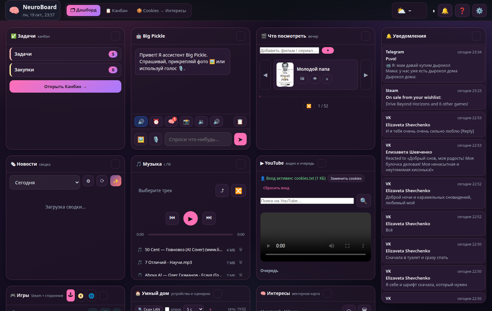 | 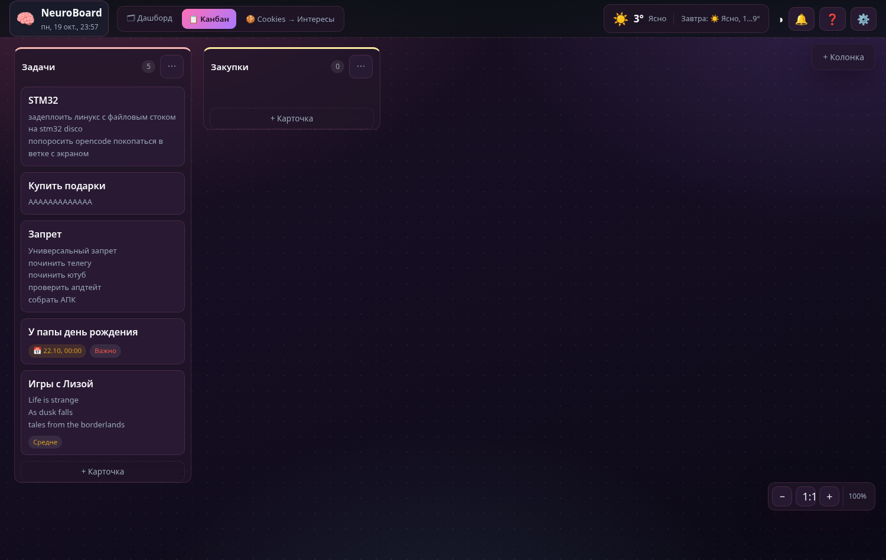 |

| Модалка карточки | Настройки |
|---|---|
| 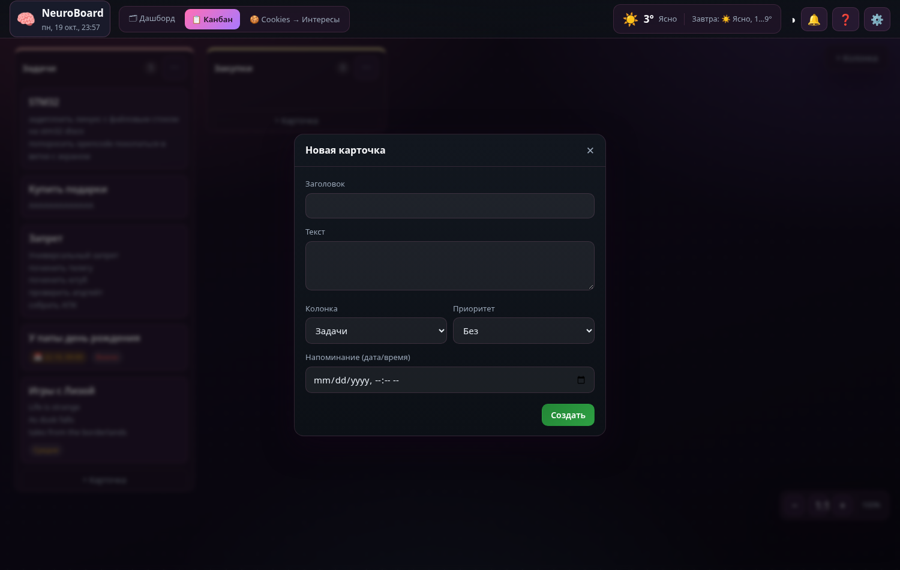 | 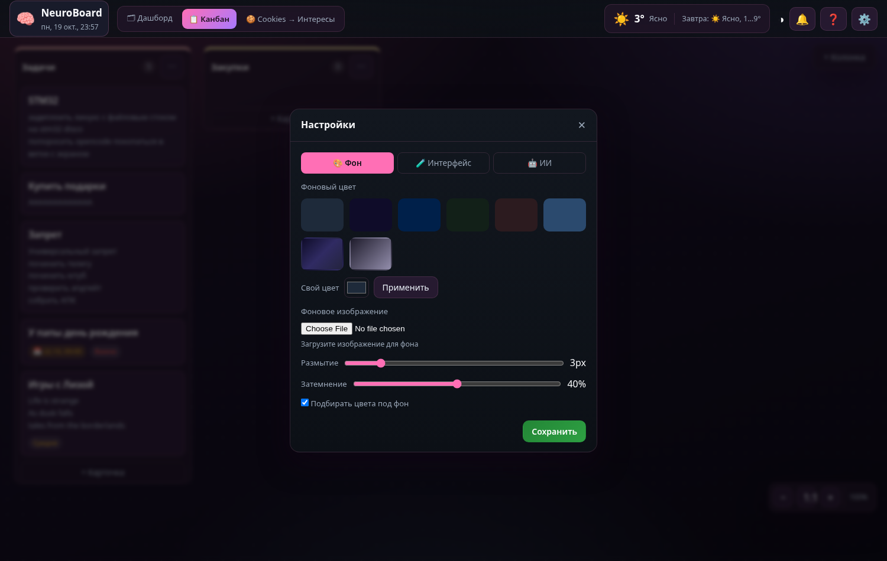 |

| События и напоминания | ИИ-панель |
|---|---|
| 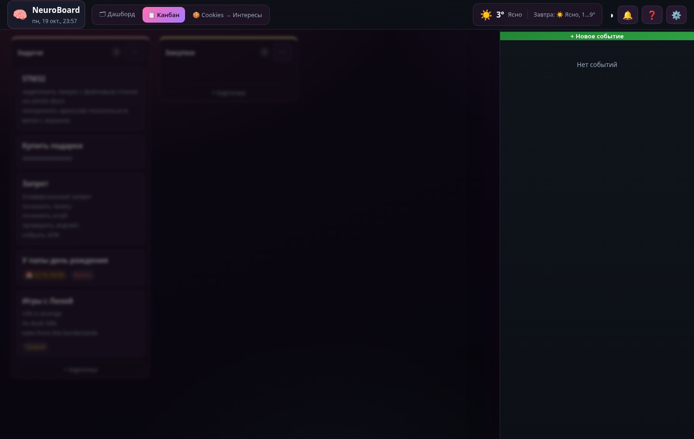 | 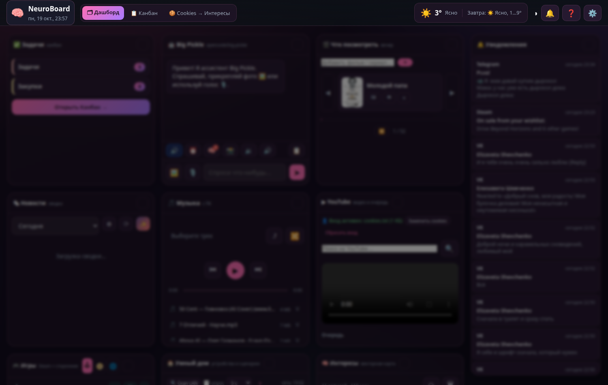 |

| Мобильная версия (телефон в LAN) | Страница приёма уведомлений |
|---|---|
| 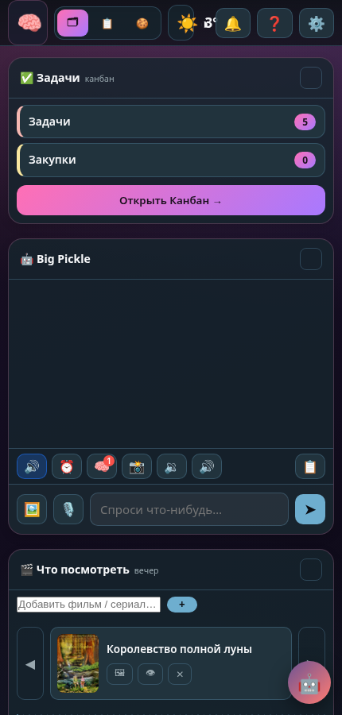 | 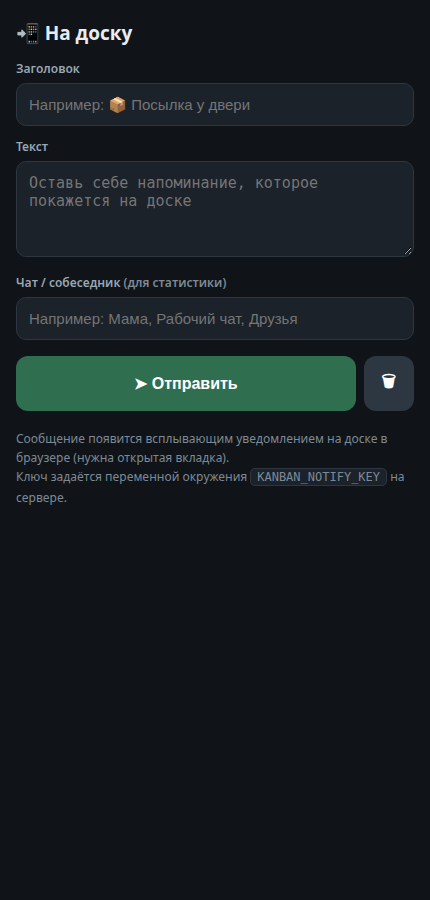 |

| Доска с зумом (Ctrl+колесо) | Фильм с постером |
|---|---|
| 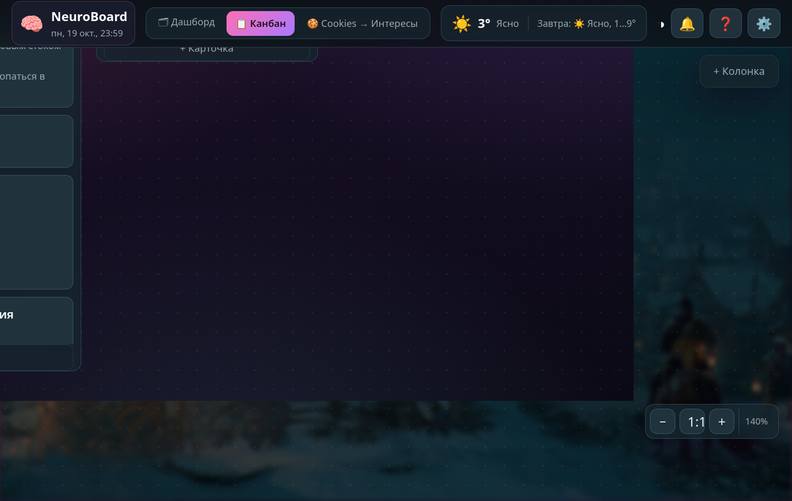 | 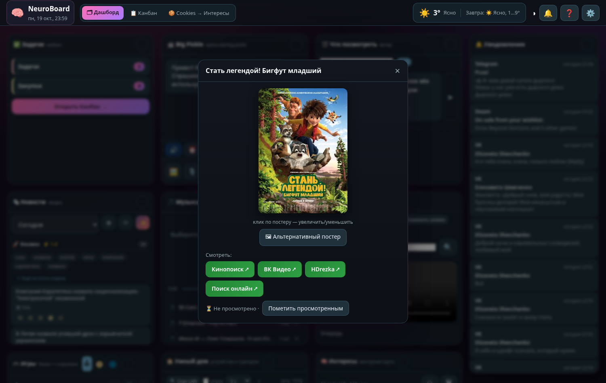 |

| Новости, музыка, уведомления | **Мини-канбан — итоговый пример курса** |
|---|---|
| 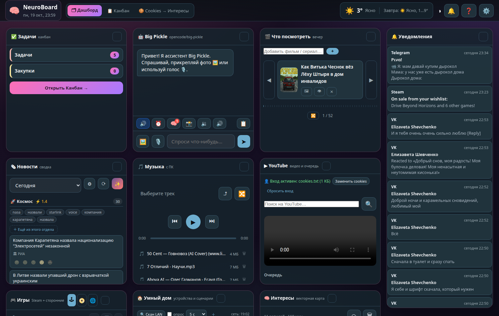 | 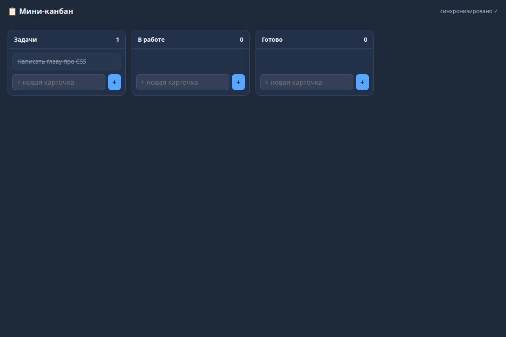 |

---

## 🧭 Кому это подойдёт

- Вы **ни разу не программировали** (или пробовали и забросили) и хотите собрать понятный, живой проект.
- Вы хотите понять, **как работают сайты**: что происходит, когда вы открываете страницу, откуда берутся данные, как телефон «договаривается» с вашим ПК.
- Вы хотите **дойти до результата**, а не учить абстрактные теории годами.

**Что вам не нужно:** опыт, платные программы, инструкции от «гуру». Нужны: компьютер с Linux/Mac/Windows, интернет и терпение.

---

## 🗺️ Маршрут курса

| # | Глава | Что узнаете | Сложность |
|---|---|---|---|
| 0 | [README (эта страница)](#чего-мы-будем-делать) | Общая картина проекта | ⭐ |
| 1 | [Как устроено веб-приложение](01-kak-ustroeno.md) | Клиент/сервер, HTTP, порты, архитектура NeuroBoard | ⭐ |
| 2 | [Окружение и инструменты](02-okruzhenie.md) | Node.js, терминал, редактор, отладка | ⭐ |
| 3 | [HTML и DOM](03-html.md) | Разметка страницы, дерево элементов | ⭐⭐ |
| 4 | [CSS: стиль и раскладка](04-css.md) | Селекторы, Flexbox, тёмная тема, переменные | ⭐⭐ |
| 5 | [JavaScript](05-javascript.md) | Синтаксис, массивы, события, `fetch`, async | ⭐⭐⭐ |
| 6 | [Сервер на Node.js](06-server.md) | HTTP-сервер, маршрутизация, JSON-API | ⭐⭐⭐ |
| 7 | [Хранение данных](07-dannye.md) | JSON-файлы, CRUD, атомарная запись, «надгробия» | ⭐⭐⭐ |
| 8 | [Фронтенд канбана](08-frontend-kanban.md) | Рендер, перетаскивание, модалки, координаты и зум | ⭐⭐⭐⭐ |
| 9 | [Уведомления в реальном времени](09-realnoe-vremya.md) | SSE, телефон → доска, звуки, лимит соединений | ⭐⭐⭐⭐ |
| 10 | [Модули и как добавлять фичи](10-moduli-i-fichi.md) | Паттерн «модуль с handle()», разбор movies/notify | ⭐⭐⭐ |
| 11 | [Итоговый проект по шагам](11-itogovyy-proekt.md) | План сборки мини-клона + задачи с приёмкой | ⭐⭐⭐⭐ |
| 12 | [Безопасность и запуск](12-bezopasnost-i-zpusk.md) | Path traversal, ключи, LAN, HTTPS, systemd, бэкапы | ⭐⭐⭐ |
| 13 | [ИИ и умный дом: следующие шаги](13-sleduyushchie-shagi.md) | Вызов ИИ, стрим, CLI для ИИ, сцены, скан сети | ⭐⭐⭐⭐ |
| — | [Ответы и подсказки к задачам](otvety.md) | Самопроверка | — |

---

## 📖 Чего мы будем делать

Мы соберём **свою версию NeuroBoard** — постепенно, слоями:

1. **Слой 1 — страница.** Простой HTML с колонками «Задачи / В работе / Готово» и карточками, которые уже выглядят красиво (CSS).
2. **Слой 2 — логика.** JavaScript, который добавляет карточки, перекидывает их между колонками, сохраняет после перезагрузки.
3. **Слой 3 — сервер.** Программа на Node.js, которая отдаёт страницу по HTTP и принимает данные: теперь доска общая для всех устройств в доме.
4. **Слой 4 — хранилище.** Данные перестают пропадать при перезапуске: JSON-файл на диске + аккуратная запись без порчи.
5. **Слой 5 — живость.** Уведомления приходят мгновенно (SSE), со смартфона на доску, со звуком и всплывающими тостами.
6. **Слой 6 — архитектура.** Проект перестаёт быть «одной болванкой»: фичи выносятся в модули, и вы умеете добавлять новые панели сами.

Итоговый рабочий пример курса — **мини-канбан** (`12-mini-kanban.png`): сервер из главы 6 + данные из главы 7 + интерфейс из главы 8. Его код проверен на практике: он реально запускается, добавляет карточки и отмечает их выполненными.

---

## 🍽 Как пользоваться курсом

1. **Читайте по порядку.** Каждая глава опирается на предыдущие.
2. **Переписывайте код руками**, а не копируйте. Ошибки — это нормально: именно на них вы учитесь.
3. **Выполняйте задачи** в конце каждой главы. Без практики теория не остаётся в голове.
4. **Сверяйтесь с ответами** в конце курса только после попытки.
5. **Ведите свой проект в отдельной папке** (например, `~/my-kanban`) — не в этом репозитории, чтобы не поломать рабочий код.

> 💡 **Правило курса:** если что-то не работает — сначала читайте текст ошибки (он всегда что-то значит), потом `Ctrl+F` по главе, потом открывайте DevTools (F12) → вкладка Console.

---

## 🛠 Системные требования

- **Node.js версии 18 или новее** (в этом курсе — 22). Проверка: `node -v`
- **Любой браузер** (Chrome/Firefox/Edge).
- **Текстовый редактор**: VS Code (рекомендую), либо встроенный.
- **Терминал**: GNOME Terminal / Konsole / Windows Terminal.
- Опционально: второй экран или телефон в той же Wi-Fi-сети — чтобы посмотреть свой проект «по сети».

---

## ❓ Частые вопросы до старта

**Это правда с нуля?** Да. Главы 1–5 не предполагают знаний. Если вы уже знаете HTML/CSS/JS — пролистните их и сделайте только задачи.

**Сколько времени?** Ориентир: главы 1–5 — 3–5 дней по 1–2 часа, главы 6–11 — ещё 4–7 дней. Успехов!

**Нужен ли интернет?** Для установки — да. Дальше почти всё локально; интернет нужен фичам вроде новостей и постеров.

**Что если у меня Windows?** Код одинаков; отличия только в командах терминала — они отмечены явно.

**Почему без фреймворков** (React и т.п.)? Потому что цель — понять, как всё устроено внутри. После курса любой фреймворк покажется понятным, а его отсутствие — не помехой.

---

## 📂 Структура репозитория NeuroBoard (наш ориентир)

```
kanban-board/
├── server.js            ← сервер: HTTP, маршрутизация, статика, API
├── assist.js            ← сервисы ассистента (TTS, память, напоминания)
├── notify.js            ← приём уведомлений с телефона + SSE
├── movies.js            ← модуль «фильмы»
├── news.js              ← модуль «новости» (RSS)
├── youtube.js           ← модуль «YouTube»
├── smart.js             ← модуль «умный дом»
├── sounds.js, music.js, games.js, messages.js, ops.js, gh.js, console.js
├── assist-cli.js        ← CLI для ИИ
├── config.json          ← настройки (СЕКРЕТЫ — не коммитить!)
├── data/
│   ├── db.json          ← доска: колонки, карточки, события, настройки
│   ├── news.json        ← новости
│   ├── movies.json      ← фильмы
│   └── …                ← по файлу на каждую фичу
├── public/              ← всё, что отдаётся браузеру
│   ├── index.html       ← главная страница
│   ├── css/style.css    ← стили
│   ├── js/app.js        ← ядро фронтенда (доска, карточки, настройки)
│   ├── js/canvas.js     ← зум и координаты
│   ├── js/notify.js     ← клиент уведомлений (SSE)
│   └── js/movies.js, news.js, … ← по клиенту на каждую фичу
└── AGENTS.md, README.md ← документация проекта
```

Правило проекта, которое мы будем повторять: **сервер держит данные и логику, браузер держит картинку и реакцию на клики, а между ними — обычный HTTP с JSON.**

---

## ✅ Чек-лист перед стартом

- [ ] `node -v` показывает версию 18 или выше
- [ ] Есть редактор кода и открытое окно терминала
- [ ] Создана папка для практики: `mkdir ~/my-kanban && cd ~/my-kanban`
- [ ] Понятна главная цель: собрать рабочую доску, а не «выучить всё»
- [ ] Время в календаре забронировано (даже 30 минут в день)

**Дальше → [Глава 1. Как устроено веб-приложение](01-kak-ustroeno.md)**
